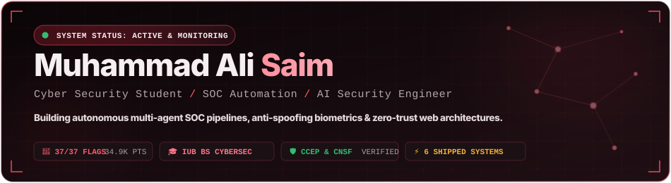

<div align="center">

  <!-- Header Banner -->
  

  <br/><br/>

  <!-- Dynamic Animated Typing SVG -->
  <a href="https://muhammadalisaim.github.io/portfolio-v2/">
    
  </a>

  <br/>

  <!-- Live Status & Badges -->
  <p align="center">
    <a href="https://muhammadalisaim.github.io/portfolio-v2/"></a>
    <a href="https://www.linkedin.com/in/muhammad-ali-saim/"></a>
    <a href="https://profile.hackthebox.com/profile/019fb8ec-0cd2-73f6-b2a5-f8ebbf55af37"></a>
    <a href="https://muhammadalisaim.github.io/portfolio-v2/"></a>
    
  </p>

</div>

---

### 🛡️ About Me

> *"Security operations, built as software."*

I am a **Cyber Security Scholar** at **The Islamia University of Bahawalpur (IUB)**, Department of Cyber Security (Faculty of Computing). My passion lies where **Security Operations (SOC) meet Autonomous Software & AI**:

- 🤖 **Autonomous SOC Pipelines**: Architecting cooperating multi-agent teams using **LangGraph, LangChain, Neo4j, and ChromaDB** that triage raw SIEM noise, enrich IOCs, graph attack blast radiuses, and draft automated containment playbooks.
- 🔐 **Zero-Trust & Secure Engineering**: Building enterprise portals hardened with **salted bcrypt hashing, JWT authentication, granular 4-tier RBAC**, route guards, strict Content Security Policies (CSP), and audit logs.
- 👁️ **Applied AI & Biometrics**: Developing browser-based anti-spoofing attendance systems powered by **TensorFlow.js & face-api.js** with **Eye Aspect Ratio (EAR)** blink state machines that defeat photo/screen replay proxy attacks.
- 🚩 **Offensive Security & CTFs**: Solved **37 out of 37 flags** (34,900 points, Rank 28th) in competitive Capture The Flag with Team *"I CAN"*.

---

### ⚡ Key Highlights & Numbers

```text
 ┌───────────────────────┬───────────────────────┬───────────────────────┬───────────────────────┐
 │       34,900 PTS      │      6 PROJECTS       │       4 AGENTS        │       5+ YEARS        │
 │  Solved 37/37 Flags   │  Shipped in 2 Months  │  SentinelMesh AI SOC  │  Esports Team Leader  │
 │   CTF Rank #28 / 100+ │  Full-Time Internship │  Triage ➔ Remediation │   Owner "UC Official" │
 └───────────────────────┴───────────────────────┴───────────────────────┴───────────────────────┘
```

---

### 🚀 Featured Engineering & Security Projects

<table>
  <tr>
    <td width="50%">
      <h3 align="center">🛡️ SentinelMesh / AegisSOC</h3>
      <p align="center"><b>Autonomous Multi-Agent Security Operations Center</b></p>
      <p align="center">
        
        
        
        
        
      </p>
      <ul>
        <li><b>4 Cooperating Agents:</b> Triage ➔ Threat Intel (VirusTotal/AbuseIPDB) ➔ Graph Blast Radius (Neo4j) ➔ Context-Aware Remediation Playbooks.</li>
        <li>Real-time <b>WebSocket incident dashboard</b> streaming live attack telemetry end-to-end.</li>
        <li><i>Submitted to AMD Developer Hackathon ACT III (lablab.ai).</i></li>
      </ul>
      <p align="center">
        <a href="https://muhammadalisaim.github.io/portfolio-v2/#work"><b>Project Details ↗</b></a>
      </p>
    </td>
    <td width="50%">
      <h3 align="center">🎟️ CAIPSD Event Ticket & Gate Portal</h3>
      <p align="center"><b>Secure Event Ticketing & Hardware-Free Entry Scanner</b></p>
      <p align="center">
        
        
        
        
        
      </p>
      <ul>
        <li>Organizer-only portal: issues cryptographically secure 16-character QR tickets with automated email delivery via SMTP & Google Apps Script fallback.</li>
        <li>Gate camera scanner with real-time state verification (Entry, Re-entry, Expired/Cancelled).</li>
        <li>Hardened with strict CSP, login rate limiting, salted bcrypt, and automated API tests.</li>
      </ul>
      <p align="center">
        <a href="https://github.com/muhammadalisaim/caipsd-event-system"><b>View on GitHub ↗</b></a>
      </p>
    </td>
  </tr>
  <tr>
    <td width="50%">
      <h3 align="center">👁️ FaceAttend</h3>
      <p align="center"><b>AI Eye-Liveness Biometric Attendance System</b></p>
      <p align="center">
        
        
        
        
      </p>
      <ul>
        <li>100% in-browser facial detection and descriptor matching with zero cloud latency.</li>
        <li><b>Eye Aspect Ratio (EAR) blink detection state machine</b> blocks proxy attendance from printed photographs, cutouts, or mobile screen replays.</li>
        <li>Bi-directional real-time sync with Google Sheets API and local CSV export.</li>
      </ul>
      <p align="center">
        <a href="https://muhammadalisaim.github.io/portfolio-v2/#work"><b>Project Details ↗</b></a>
      </p>
    </td>
    <td width="50%">
      <h3 align="center">🎙️ AI Mock Interview Coach</h3>
      <p align="center"><b>Voice-First AI Interview Practice & Scoring Simulator</b></p>
      <p align="center">
        
        
        
        
      </p>
      <ul>
        <li>Real-time speech-to-text with conversational follow-up questions tailored to user background.</li>
        <li>Evaluates answers against the <b>STAR methodology</b>, analyzing speaking speed (WPM), filler word frequency, and English fluency.</li>
        <li>Includes 7-day personalized practice drills and interactive performance charts.</li>
      </ul>
      <p align="center">
        <a href="https://muhammadalisaim.github.io/portfolio-v2/#work"><b>Project Details ↗</b></a>
      </p>
    </td>
  </tr>
  <tr>
    <td width="50%">
      <h3 align="center">🔑 Enterprise Authentication & 4-Tier RBAC</h3>
      <p align="center"><b>Security-Hardened Access Control Engine</b></p>
      <p align="center">
        
        
        
        
      </p>
      <ul>
        <li>Four-tier role model: <code>Intern</code> ➔ <code>Lead Head</code> ➔ <code>Manager</code> ➔ <code>SuperAdmin</code>.</li>
        <li>Granular route-guarding middleware, automated session expiry, and audit logs tracking auth anomalies and brute-force attempts.</li>
      </ul>
    </td>
    <td width="50%">
      <h3 align="center">📋 DTRS (Daily Task Report System)</h3>
      <p align="center"><b>Internship Deliverable & Blocker Tracking System</b></p>
      <p align="center">
        
        
        
        
      </p>
      <ul>
        <li>Multi-stage review workflow (<code>Submitted</code> ➔ <code>Reviewed</code> ➔ <code>Flagged</code>).</li>
        <li>Automated PDF team user-manual generator and blocker escalation logging.</li>
      </ul>
    </td>
  </tr>
</table>

---

### 🧰 Technical Arsenal & Skills

<table align="center" width="100%">
  <tr>
    <td width="25%"><b>🛡️ Cybersecurity & SOC</b></td>
    <td>
      
      
      
      
      
      
      
      
      
      
    </td>
  </tr>
  <tr>
    <td width="25%"><b>🤖 AI, LLMs & Agents</b></td>
    <td>
      
      
      
      
      
      
      
      
      
    </td>
  </tr>
  <tr>
    <td width="25%"><b>💻 Languages & Stacks</b></td>
    <td>
      
      
      
      
      
      
      
      
      
      
      
    </td>
  </tr>
  <tr>
    <td width="25%"><b>🗄️ Database & DevOps</b></td>
    <td>
      
      
      
      
      
      
      
      
      
      
    </td>
  </tr>
</table>

---

### 📜 Certifications & Honors

- 🏅 **Certified Cybersecurity Educator Professional (CCEP)** — *Red Team Leaders (Credential ID: [ea13f8ff1f5ad2da](https://courses.redteamleaders.com/exam-completion/ea13f8ff1f5ad2da))*
- 🌐 **Certified Network Security Fundamentals (CNSF)** — *Red Team Leaders (Issued 20 November 2026)*
- 📊 **Splunk Fundamentals** — *Master Data Onboarding, Search, and Security Monitoring*
- 🛡️ **ISC2 Candidate** — *Official member & candidate of ISC2*
- 🚩 **Capture The Flag (CTF)** — *Team "I CAN": Solved 37/37 Flags for 34,900 Points (Ranked 28th)*
- 💻 **5th Digital Pakistan Cybersecurity Hackathon** — *Ministry of IT & Telecom with Ignite, Bahawalpur*
- 🚀 **Cloudflight Coding Contest (CCC 42)** — *Participated in Classic, Data/AI, and School Tracks*
- ⚔️ **Black Vault Cyber Security Workshop** — *Network Defense, Threat Hunting, and Incident Response*

---

### 📊 GitHub Activity & Real-Time Analytics

<div align="center">

  <table border="0">
    <tr>
      <td align="center" width="50%">
        
      </td>
      <td align="center" width="50%">
        
      </td>
    </tr>
    <tr>
      <td colspan="2" align="center">
        
      </td>
    </tr>
  </table>

  <!-- Contribution Snake Animation -->
  <h4>🐍 GitHub Contribution Snake</h4>
  <picture>
    <source media="(prefers-color-scheme: dark)" srcset="https://raw.githubusercontent.com/muhammadalisaim/muhammadalisaim/output/github-contribution-grid-snake-dark.svg">
    <source media="(prefers-color-scheme: light)" srcset="https://raw.githubusercontent.com/muhammadalisaim/muhammadalisaim/output/github-contribution-grid-snake.svg">
    
  </picture>

</div>

---

### 🤝 Let's Connect & Build Something Secure

<div align="center">

  <p>I am actively seeking <b>internships and entry-level positions</b> in <b>SOC Operations, Threat Detection, Security Engineering, or AI Security</b>.</p>

  <p>
    <a href="https://muhammadalisaim.github.io/portfolio-v2/" target="_blank">
      
    </a>
    <a href="https://www.linkedin.com/in/muhammad-ali-saim/" target="_blank">
      
    </a>
    <a href="https://profile.hackthebox.com/profile/019fb8ec-0cd2-73f6-b2a5-f8ebbf55af37" target="_blank">
      
    </a>
    <a href="mailto:saimmalik4728@gmail.com">
      
    </a>
    <a href="tel:+923287617476">
      
    </a>
  </p>

  <p>📍 <i>Kot Addu, Punjab, Pakistan · The Islamia University of Bahawalpur</i></p>

</div>
